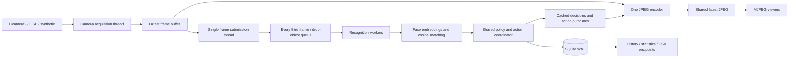

# Architecture and API

[Back to the project](../README.md)

## Current data flow

Recognition receives uniquely numbered camera frames from one background producer.
Viewing the stream is optional and extra viewers do not submit duplicate work.
A single encoder publishes unique JPEG frames to a shared cache. Slow viewers skip
frames without blocking the encoder. Delivery timestamps use a monotonic clock;
stale work and older completions are dropped before action/publication.
The Pi evaluator instantiates this same runtime with a temporary gallery database
and no physical actuator. See [measurement scope](benchmarking.md).

## Modules

| Module | Responsibility |
| --- | --- |
| `src/app.py` | Flask routes, pipeline startup and MJPEG responses. |
| `src/templates/`, `src/static/` | Dashboard markup, responsive styles, interactions and locally hosted font. |
| `src/runtime.py` | Shared web/benchmark lifecycle, producer, encoder, timestamped decisions and telemetry. |
| `src/camera.py` | Threaded latest-frame capture and camera backends. |
| `src/recognition_engine.py` | Detection, embedding matching, overlays, queue, workers. |
| `src/enroll.py` | Single-face validation, quality measurement, SQLite persistence. |
| `src/database.py` | Connection pool, schema, indexed queries, sessions, logging. |
| `src/utils.py` | CSV audit reports and traffic analytics. |
| `src/config.py` | Paths, environment variables, and tuning constants. |
| `src/benchmark.py` | Labelled real-image evaluation and Pi 5 camera measurement. |

Recognition uses the pretrained dlib model through `face_recognition`. Missing
models and extraction errors are reported; no fabricated boxes or embeddings
are produced. A single background producer submits camera frame IDs independently
of browser clients. All workers share policy, action cooldown and audit coordination
in `src/access.py`. See [decision behavior](decision-safety.md).

## Storage

SQLite contains `identities`, `enrollment_history`, `access_log`, `sessions`, and
`performance_metrics`. Active matching uses one current embedding per identity;
enrollment history is not a multi-template recognition gallery. Database and
embedding paths are relative to the repository through `src/config.py`, rather
than the shell's current directory.

## HTTP API

| Endpoint | Method | Purpose |
| --- | --- | --- |
| `/` | GET | Dashboard. |
| `/stream.mjpg` | GET | Annotated MJPEG stream. |
| `/api/stats` | GET | Current telemetry and aggregate history. |
| `/api/logs` | GET | History filters: `name`, `hours`, `limit`. |
| `/api/csv` | GET | CSV export filters: `name`, `hours`. |
| `/api/identities` | GET | Enrolled identity metadata. |
| `/api/enroll` | POST | Administrator-authenticated live capture enrollment. |
| `/health` | GET | Basic service status. |

Dashboard, video, read APIs, and health checks require HTTP Basic credentials
(username `admin`, password `ADMIN_ENROLLMENT_TOKEN`) or a bearer token. Enrollment
and quality-check POST requests require an explicit bearer token. Unconfigured
credentials disable access. See [authentication](enrollment.md) for HTTPS deployment
and request formats, and [benchmarking](benchmarking.md) for telemetry limitations.
