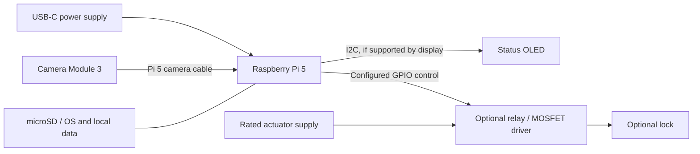

# Hardware guide

[Back to the project](../README.md)

Hardware for the Raspberry Pi 5 face-recognition and access-control system.
The maintainer confirms the required parts are available. This folder documents
assembly requirements; it does not claim that hardware validation has passed.
Exact OLED and actuator models and the installed GPIO assignments have not been
recorded in this repository yet.

| Guide | Contents |
| --- | --- |
| [Parts and requirements](requirements.md) | Core parts, optional indicators, and lock-specific requirements |
| [Connections](wiring.md) | Camera, power, cooling, OLED reference pins, and actuator interface |
| [Bring-up checklist](bring-up.md) | Functional checks first; measurements last |
| [Deployment record template](deployment.example.md) | Record actual parts, wiring, and validation results |

The diagram shows functional connections, not a circuit schematic. Software
installation is in [Raspberry Pi setup](../docs/raspberry-pi-setup.md). The
[decision and actuator contract](../docs/decision-safety.md) explains how the
application reports actions. Physical GPIO/OLED drivers must match the selected
modules; the repository currently exposes an actuator callback rather than a
preconfigured pin driver.

Copy `deployment.example.md` to `deployment.local.md` for private installation
notes. Local deployment records and `hardware/local/` are ignored by Git. Publish
only reviewed, non-sensitive diagrams or photographs without enrolled faces.
